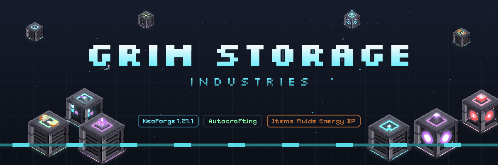
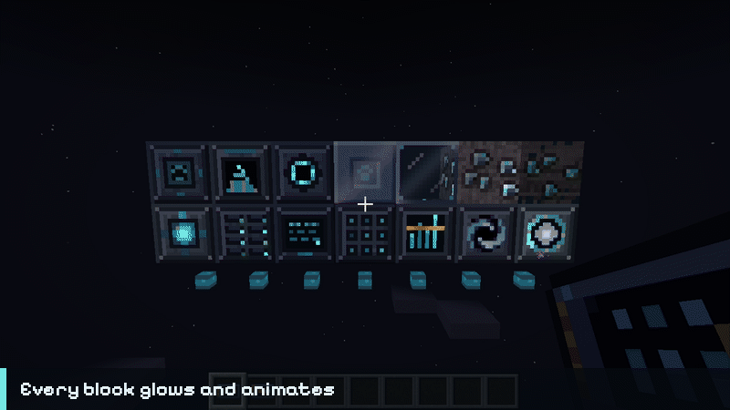

<p align="center"></p>

# Grim Storage Industries

Dead-simple storage for NeoForge 1.21.1 that still scales to end game, with autocrafting built in.
No channels, no byte/type limits, no cable rules: anything touching the network joins it.
Part of the Grim Industries family with **Grim Soul Industries** and **Grim Pipe Industries**.

Made by **xTri6** for the Nine Craft modpack.

<p align="center"></p>

## Getting started

Every player gets a **Grim Storage Guide** the first time they join. It explains everything below, with live recipes.
Lost it? Craft one from a book and a Soulite Ingot.

1. Mine **Soulite** (Overworld Y -48 to 16) and smelt it into ingots.
2. Craft a **Network Controller**, a **Soul Drive** and a **Copper Storage Cell**. Put the cell in the drive.
3. Place a **Soul Terminal** touching the network. Open it and start storing.
4. Use **Soul Cable** or **Soulite Glass** to reach blocks that are not touching.
5. Run cable up to any chest, tank or machine and use an **Import Bus** or **Export Bus** on it. The bus clips onto the
   end of the cable and moves things in or out.

## Blocks

| Block | What it does |
|---|---|
| Network Controller | The heart of a network. Exactly one per network. Open it to see storage use and crafting jobs (and cancel them). |
| Soul Drive | Holds 8 storage cells. Cells keep their contents when moved. |
| Soul Terminal | An Everything tab shows items and every other resource in one list. Browse, search (`@mod` searches by mod), filter with the side tabs (ores, ingots, tools, armor, food, mob drops, farming, building, misc, and Craftable for everything the network can make), take, store, order crafts, and craft by hand in the built-in 3x3 grid that refills itself from storage. Hold Shift and nothing moves, so you can shift-click the same spot again and again. A Crafting jobs tab shows every running craft step by step. Settings (the gear): share the search with JEI, type to search on open, keep the search, and size (Auto, Normal, Tall, Taller). |
| Soul Cable / Soulite Glass | Connect network blocks. Cable is 4 px thick and each of its sides can hold an Import or Export Bus. One cable carries everything (items, fluids, energy, XP, chemicals, Source) to every bus, interface and machine on the network. The glass is decorative and see-through. |
| Soul Assembler | Holds 9 Recipe Cards and runs them. Up to 4 Speed Upgrades, each doubling its speed. |
| Processing Interface | Faces any machine (any mod). Sends Processing Card inputs in and pulls the outputs back. |
| Chest Link | Clips onto a chest, barrel or drawer and makes it part of storage: in and out, only in, or only out, and optionally filled before the cells. |
| Redstone Emitter | Redstone signal when an item is at least or below an amount, or crafts the item up to that amount while powered. |
| Machine Bus | Clips onto a machine like a bus and learns every recipe it can make, no cards needed: furnaces, smokers and blast furnaces, and machines from Mekanism, Create, Ender IO, Ars Nouveau, Immersive Engineering, Powah, Modern Industrialization, Oritech and Actually Additions (others by name, or add them with a `grimstorage_machines` datapack file). Keeps furnaces fuelled, powered machines charged and tanks topped up with fluids and chemicals from the network, takes back every output (extras like sawdust too, and fluids and chemicals the machine makes), and opens Mekanism machine sides by itself. Machines that only take and make chemicals (Chemical Washer, Crystallizer, Infuser, Separator) work too, so whole Mekanism ore lines plan as one craft. Gives an Ars Nouveau Imbuement Chamber exactly the Source each recipe costs. Several on several furnaces share big jobs. Holds 9 Processing Cards for any other machine. |
| Stock Keeper | "Always keep N of this": up to 9 items it keeps crafted. |
| Import Bus | Sticks onto the face of any block (chest, tank, furnace, generator, any modded machine) and pulls items, fluids, energy, XP, chemicals and Source from it into the network. Facing open air it picks up dropped items and XP orbs. 9-slot filter (whitelist/blacklist, exact or ignore-NBT) and an on/off switch per resource. |
| Export Bus | The reverse: pushes from the network into the block it is on. Sends only the items you pick by default; switch on fluids, energy, XP, chemicals or Source to send those too. |
| (both buses) | Pipes from any mod plug into a bus on any side: pipes push into an Import Bus, and pull out of an Export Bus (only what its filter and switches allow). Tested with Grim Pipe Industries omni pipes and hoppers. |
| Network Interface | Lets pipes, hoppers and other mods use the network. Items, fluids, energy, XP, chemicals and Source can all be pushed in. Items can only be pulled out if you pick them in its 9 slots; the other resources each have a Pull switch (off by default). |
| Void Filter | When storage is full, the items you pick are destroyed instead of backing up. |
| Quantum Link | Joins two networks across any distance or dimension. Pair two links with a Soul Tether. Both sides must be loaded. |
| Soul Infuser | The mod's machine: Soulite Ingot + Soul Sand + Quartz makes Infused Soulite. Pipes insert from any side and pull the output. |

## Items

| Item | What it does |
|---|---|
| Storage Cells | Copper 4k, Gold 64k, Diamond 1M, Netherite 64M items. Any mix of item types. |
| Fluid Cells | 256 / 4,096 / 65,536 / 1M buckets. Any mix of fluids. |
| Chemical Cells | Same sizes, for Mekanism gases, infuse types, pigments and slurries (needs Mekanism). |
| Energy Cells | 16M / 256M / 4B / 64B FE. |
| Experience Cells | 100k / 2M / 50M / 2B XP. Liquid XP from other mods (`c:experience`) converts at 20 mB per point. |
| Source Cells | 10k / 100k / 1M / 10M Source (needs Ars Nouveau). |
| Singularity Cell | Unlimited amount of one item. Use it with that item in your off hand to lock it. |
| Recipe Card | Use it, click items into the 3x3 grid, and it saves the crafting recipe. No items needed with JEI: press + on any crafting recipe, or drag items from JEI onto the grid. The terminal's pencil button writes its crafting grid onto a card. Sneak-use to clear. |
| Processing Card | Same, for machines: what goes in, what comes back. Right-click a slot to add one more. JEI's + on a recipe of any mod fills both sides in. |
| Wireless Terminal | Sneak-use on a controller to bind. 128 block range, same dimension. |
| Singularity Terminal | Wireless terminal with unlimited range, any dimension. |
| Speed Upgrade | Doubles a Soul Assembler's speed (up to 4), or adds a bus's base speed again (up to 8 per bus, for 9x). |
| Soul Wrench | Cut or rejoin cable connections, take buses off cable, turn machines to face the side you click, and sneak-click to pick up Grim Storage blocks. |

**Look and feel:** every screen uses a translucent dark theme by default. Click the sun/moon button in a screen's
corner to switch to light mode; panel opacity is in the mod's Config screen (mod list) or `config/grimstorage-client.toml`.

**Dump key (G by default):** while carrying a bound wireless terminal, press it to send your main inventory
(not hotbar or armor) into the network.

## Autocrafting

Put Recipe Cards in a Soul Assembler on the network. Craftable items show in the terminal with a "Craft" label.
Click one (or ctrl-click / middle-click any craftable item), type an amount, and the network works out the
whole tree: it uses what is stored, crafts what is missing (including sub-recipes), and tells you exactly
what it is missing if it cannot. Machine steps use Processing Cards in a Processing Interface or Machine Bus, and a Machine Bus on a furnace learns its recipes by itself. When an item can be made more than one way, the network picks a way it has the ingredients for.
Fluids and chemicals that machines make are planned as steps too: order Iron Crystals and the network runs the Chemical Washer
and then the Crystallizer.

The terminal's crafting tab is a queue: move jobs up or down (shift-click to send one to the top), pause and resume them, or
cancel them. Jobs higher up get the Soul Assemblers and machines first. Each player can run up to 16 jobs on a network at once
(`maxJobsPerPlayer` in `config/grimstorage-common.toml`, next to `maxJobsPerNetwork`).

## Progression

| Tier | Gate | Unlocks |
|---|---|---|
| 1 | Soulite Ingot | Controller, Drive, Terminal, Cable, Glass, Interface, Import Bus, Export Bus, Copper Cell, Soul Infuser |
| 2 | Soulite + Gold | Gold Cell, Recipe Cards, Soul Assembler, Void Filter |
| 3 | Infused Soulite | Diamond Cell, Speed Upgrade, Stock Keeper, Wireless Terminal, Processing Card, Machine Bus |
| 4 | Echo Soulite Alloy | Netherite Cell, Processing Interface, Quantum Link, Soul Tether |
| 5 | Singularity Core | Singularity Cell, Singularity Terminal |

## Ores

| Block | Where |
|---|---|
| Soulite Ore, Deepslate Soulite Ore | Overworld, Y -48 to 16. Iron pickaxe. |
| Soul Sand Soulite Ore | Soul Sand Valleys. Drops 2-3 Raw Soulite. |
| Echo Soulite Ore | Deep Dark only. Drops Echo Soulite Shards. Diamond pickaxe. |

## For pack makers

- The guide's text is in `assets/grimstorage/guide/en_us.json`. Override it with a resource pack to change or translate it
  (add `guide/<language>.json` for other languages). Pages support `**bold**`, `` `highlight` `` and `- ` bullet lists, plus
  `items` and `recipe` fields that are drawn live.
- Turn off the first-join book with `giveGuideOnFirstJoin` in `config/grimstorage-common.toml`.

- Common `c:` tags throughout (`c:ores/soulite`, `c:ingots/soulite`, `c:gems/echo_soulite`, ...).
- Every recipe, loot table and ore feature is datapack JSON. Override files in
  `data/grimstorage/worldgen/placed_feature/` or `data/grimstorage/neoforge/biome_modifier/` to change ore generation.
- Soul Infuser recipes use the `grimstorage:infusing` type, so you can add your own:

```json
{
  "type": "grimstorage:infusing",
  "ingredients": [{"tag": "c:ingots/soulite"}, {"item": "minecraft:soul_sand"}, {"tag": "c:gems/quartz"}],
  "result": {"id": "grimstorage:infused_soulite", "count": 1},
  "time": 100
}
```

## Fluids, chemicals, energy, XP and Source

Put the matching cell in any Soul Drive. In the terminal, the tabs along the top switch between Items, Fluids, Chemicals,
Energy, Source and Experience. Click a fluid with an empty bucket (or any tank) to fill it, or click anywhere with a full one to store it;
chemicals work the same way with Mekanism tanks. In the Experience tab, click to take a level, shift-click for 10, right-click to
store all of your XP.

The easiest way to move these resources is a bus: an Import Bus on a generator stores its power, on a tank empties it, and
under a mob farm soaks up XP orbs and drops. You can also use pipes with a Network Interface: push in from any side, and flip
its Pull switch for a resource to let pipes take it back out.

## Import and Export Buses

- **On cable:** run Soul Cable up to a chest or machine and use the bus on that block (or on the cable). The bus
  goes onto that side of the cable, facing the block. Right-click it for its screen; break it to take just the bus off.
  One bus per cable side, and the network never passes through a side with a bus.
- **On its own:** use the bus on a block with no cable next to it and it places as its own block on that face.
- **Import Bus (cyan)** takes things out of the block into the network; **Export Bus (orange)** sends things from the
  network into the block, only what you pick. Placed the wrong one? The direction button in its screen switches it.

- Place against the block you want to use; the bus sticks to that face. Run cable to its back. The network never connects
  through a bus's front, so a bus facing another network's interface moves things between the two networks without merging them.
- Filter: 9 ghost slots. Buckets and tanks filter their fluid or chemical. **Only these** (whitelist) or **All but these**
  (blacklist); **Exact match** or **Ignore NBT**. Energy, Source and XP have no types, so their switch alone decides.
- Defaults: the Import Bus pulls everything; the Export Bus sends only what is in its filter.
- Pipes: every side of a bus takes pipes from any mod (items, fluids, FE, Mekanism chemicals, Ars Source, liquid XP).
  Pipes can push into an Import Bus, and pull out of an Export Bus whatever its filter and resource switches allow.
- Speed: a busy bus runs every tick and moves up to 128 items, 32 buckets, 32,000 mB of chemicals, 10,000 XP or Source,
  and as much FE as the block allows. An idle bus backs off to checking about once a second and wakes as soon as a
  neighbour changes. Measured in the dev check: 255 buses cost about 0.1 ms per server tick in total.

## Look and feel

- Every network block is animated, with a glowing layer that stays bright in the dark: controller and quantum link rings
  chase around their cores, drive LEDs blink, the terminal screen scans, the stock keeper's bars rise and fall, cable
  pulses along its length, bus rings spin, and Soulite ore glints. The controller, quantum link and void filter give off
  soul wisps.
- Cells show their tier at a glance: a tier-colored cap, 1 to 4 lights down the side, a moving shine on Diamond, glowing
  ember seams and the enchant glint on Netherite, and brighter name colors per tier (plus a colored tier line in the tooltip).
- Encoded Recipe and Processing Cards glint, blank ones do not.

## JEI

With JEI installed, Soul Infuser recipes have their own page (click the arrow in the infuser, or look up Infused Soulite),
and chemical or Source cells are hidden when Mekanism or Ars Nouveau is not installed.

## Known limits

- Crafting jobs in progress are not saved when the world closes; restart the craft after loading.
  Stored items are always saved.
- Quantum Links do not keep chunks loaded; the far side must be loaded (or chunk-loaded) to connect.
- Processing Cards hold items only. Fluid and chemical steps come from what a Machine Bus learns from the machine.
- You order items. A fluid or chemical can't be ordered on its own, only made as a step towards an item.
- Ars Nouveau recipes that need items on pedestals are not learned (the network can't place those).
- New Mekanism tanks start with their chemical sides closed. Open the side a bus touches with a Configurator, the same as
  for any pipe. (A Machine Bus on a Mekanism machine opens the sides it needs by itself, only ones you haven't set.)

## Building

Install JDK 21, then double-click `BUILD.bat` (Windows) or run `./gradlew build`. The jar lands in `build/libs/`.

Dev checks (never shipped in the release jar):
- `./gradlew runOreCheck` generates terrain and counts ore in every Soulite location.
- `./gradlew runSystemCheck` builds a network in a test world and checks storage, autocrafting, machine processing,
  stock keeping, voiding, pipe access, terminal clicks, card editing, a Nether Quantum Link, Import/Export Buses, XP, and
  the tick cost of 255 idle buses. Run it twice to
  also check that everything survives a restart.
- `./gradlew runShots` opens screens, the guide and JEI in a real client on that world and saves screenshots.
- Drop other mod jars into `libs-dev/` (ignored by git) to run them in dev. With Grim Pipe Industries there, the system
  check also wires real omni pipes into an Import Bus and out of an Export Bus.

## License

All Rights Reserved. See [LICENSE](LICENSE).
